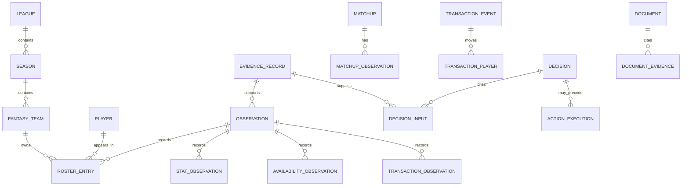

# ShotCaller storage and future database

**Use the existing Railway volume now: JSON holds evidence and numbers; Markdown holds reasoning.** Neither a database server nor a graph database is needed. When file queries become cumbersome, add one SQLite file on the same volume. This does not require another paid service.

The accompanying [SQLite DDL](../schema/shotcaller.sql) is a future design, not a migration executed by the application. Current runtime persistence remains `app/store.mjs`.

## Current source of truth

| Record | Storage | Meaning |
|---|---|---|
| Captures and imports | `/data/snapshots/<record-id>/snapshot.json` | Immutable evidence, including original dates, coverage and raw tables where available |
| Decisions | `/data/decisions/<decision-id>/snapshot.json` | Advice plus task, model, prompt fingerprint and input snapshot IDs |
| Decision briefs | `/data/decisions/<decision-id>/brief.md` | Human-readable reasoning linked to evidence |
| Historical Markdown and source attachments | Private files or imported evidence bundles | Context and source material; never replace structured statistics |
| Complete-capture pointer | `/data/latest.json` | Most recently published complete browser capture, not necessarily the newest evidence for every subject |
| Consolidated view | Derived from saved evidence | A read model; it must retain the source and observation date of every section |

Historical imports are wrapped in version-2 store records with their original payload preserved. Their import time does not become their observation time. Manual snapshots can include several unrelated periods in one file: a weekly matchup, one day's player results, future lineups and season-average waiver statistics. Each needs its own scope and time label.

Do not merge everything into a mutable `current-team.json`. Append observations and compute the current view by league, season, subject, period, value kind, aggregation basis and verified coverage. A recently imported old screenshot must not overwrite fresher observations. A partially captured waiver list cannot prove unlisted players are unavailable.

## What SQLite adds later

SQLite provides joins, indexes and enforced relationships while the existing JSON files remain the evidence archive. The initial database is a rebuildable index over those files. Markdown remains useful for scouting hypotheses, weekly reviews and decision explanations; it is not the numeric database.

### Identity

- Internal IDs are UUIDs. Yahoo IDs/keys are separate nullable fields, unique in their actual scope. Fantasy team IDs belong to a season; player identity spans observations.
- When screenshots lack provider IDs, create an explicitly provisional internal identity. Keep the displayed name as evidence; never manufacture a Yahoo ID or merge players solely because names look similar.
- Resolve provisional identities from verified links before merging. During initial backfill, keep a reviewed identity mapping alongside the importer. Preserve original names, positions and team labels in the source record.

### Observation, period and quality

`evidence_record` identifies exact archived bytes by SHA-256 and records when they entered the store. Its rows cannot be updated or deleted. A correction is a new record linked through `supersedes_id`.

`observation` identifies a table or subsection inside that evidence using a source locator. It records:

- **Observed time:** when the source was actually viewed, with instant/date/unknown precision and timezone. Unknown capture times stay unknown.
- **Period:** the scoring day, fantasy week, season or explicit range being measured.
- **Value and basis:** actual versus projected; totals versus per-game/per-minute values. These are separate dimensions.
- **Coverage and finality:** complete/partial/unknown capture; live/provisional/final/unknown results; validation status and a concrete coverage note.
- **Normalization:** parser version and normalization time, permitting a new interpretation without changing evidence.

An effective date belongs on the thing that becomes effective: a roster scoring date, waiver clearing time or transaction effective date. It is not interchangeable with observation or ingestion time. Provider dates must retain the provider's verified scoring timezone; a viewer's local timezone does not redefine the scoring day.

### Numbers, rosters and matchups

`stat_observation` holds the MVP's fixed basketball categories, makes, attempts, games and minutes. `NULL` means absent or unknown; `0` means observed zero. Store percentages shown by the page separately from makes and attempts. Calculate aggregate FG% and FT% from summed makes/attempts, never by averaging displayed percentages. Zero attempts produces an undefined percentage, not 0%.

The observation defines units. Per-game figures may be fractional; totals should be integral where appropriate. Do not reconstruct missing shooting volume from rounded averages. Missing minutes remain null, even when a page's total row displays a placeholder zero. Normalize `ST` and `st` to `stl`; retain the original source.

`roster_entry` records ownership and active/bench/IL placement for a particular scoring date, together with eligibility, injury flag and whether a game is scheduled. The scoring date remains null if a screenshot does not establish it. One observation can contain several future dates. A missing row is evidence of a drop only after coverage is known complete and a transaction is confirmed.

`matchup` identifies the two teams and week; `matchup_observation` links each team's statistics and displayed remaining games. Raw scheduled games are not the same as usable starts: a lineup conflict can reduce starts. Do not label a remaining-games count as optimized starts unless that calculation exists.

### Availability and behavior history

`availability_observation` stores free-agent/waiver/rostered status and any verified clearing or add-effective dates. A candidate watchlist is only a subset, not a complete market inventory.

`transaction_observation` preserves what was seen, including offers, rejected trades, uncertain history rows and roster differences. `transaction_event` represents a confirmed occurrence. Each confirmed event can link several player movements through `transaction_player`, supporting add/drop pairs and multi-player trades.

An event can be confirmed while its exact time remains unknown. Preserve a displayed timestamp as text if its timezone cannot be established. Do not invent midnight, infer transaction time from first observation, or collapse two same-player moves into one without evidence. Prefer provider transaction keys; otherwise deduplicate conservatively using reviewed source evidence. One move is an example, not a proven manager tendency.

### Documents, decisions and execution

`document` versions Markdown and prompt files by content hash. `document_evidence` records their source links. This gives the useful relationships of a knowledge graph without introducing a graph engine.

`decision` and `decision_input` preserve the recommendation's source records, model identifiers, task, timestamp, prior decision, input hash and master-prompt hash. Provider calls also reference the exact archived master-prompt version. Imported historical advice may lack a model or prompt fingerprint: retain nulls and explain the gap, rather than inventing provenance.

`action_execution` is separate. A recommendation, approval, attempted action and confirmed Yahoo change are different facts. Store authorization evidence and outcome for actual attempts; do not turn an empty `actions_executed` array into an action. A rejected trade stays rejected, not executed.

## Safe migration path

1. Back up the volume and inventory every JSON, report and source attachment by relative path and hash. Keep credentials, session files and private league data out of the public repository.
2. Create `/data/shotcaller.sqlite` from the DDL in a staging copy. Enable foreign keys on every connection. Retain one app replica and one writer; take SQLite-aware backups rather than copying an open database file alone.
3. Load archived record manifests first. Preserve existing store IDs, original payload IDs, original timestamps and exact files. Import linked Markdown and source attachments privately.
4. Normalize each supported source format into scoped observations with reviewed identity mappings. Unsupported rows remain accessible as raw evidence and are reported as unnormalized. Record parser version; make retries idempotent by source record, locator and version.
5. Compare the SQLite-derived dashboard with the file-derived dashboard before switching reads. The first migration does not change the capture writer, enable Yahoo mutations or require a separate database service.

DDL constraints cover basic structure, nonnegative numbers, valid percentages, same-season references and shooting/rebound arithmetic. The importer must additionally verify time formats and precision, subject/team consistency across matchup links, complete-team coverage, whole-number totals, source locator validity and identity mappings. SQLite cannot infer those meanings from a raw source page.

Validation should cover duplicate-import retries, same-name identities, zero versus missing values, average versus total separation, a newer import of older evidence, partial rosters, uncertain transaction timestamps and live stat corrections. Reconcile player totals with team totals only when their periods, scopes and freshness agree; preserve and surface mismatches. Confirm snapshot counts and hashes, run `PRAGMA foreign_key_check` and `PRAGMA integrity_check`, and test restore from backup before enabling SQLite reads.

**No runtime database migration is included with this design.** The current volume-backed JSON store remains authoritative until the importer and reconciliation checks are implemented.
