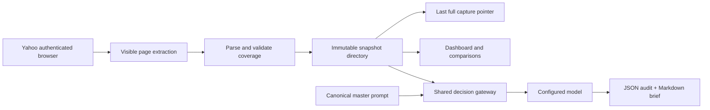

## Goal Capsule

Turn the existing design and historical records into a small, runnable private application. Preserve evidence over time and make every model-assisted decision use the canonical ShotCaller prompt. Keep the single Railway application and volume design.

## Product Contract

### Summary

Users can capture league evidence, inspect history and category comparisons, and request a sourced decision brief through one dashboard. Browser capture, structured data and decision records persist as files. Live access is verified separately from historical imports and controlled browser tests.

### Problem Frame

The current HTML is a concept and screenshots are difficult to compare. The master prompt exists but nothing enforces it at runtime. Yahoo authentication and changing tables can produce misleading data unless capture failures are explicit.

### Requirements

- R1: Preserve the exact canonical prompt at `prompts/shotcaller-system.md` and inject it through the system role on every decision call, including follow-ups and opponent analysis. Missing/empty prompt prevents calls.
- R2: Store immutable, dated JSON evidence and linked Markdown reports on a volume, with original capture time, URL, coverage and content digest. Never relabel historical imports as fresh captures.
- R3: Support authenticated, read-only headless Yahoo capture of settings, all ten team rosters, matchups, team statistics, paginated player availability and transaction history. Retain raw visible tables/text for inspection; report coverage gaps explicitly.
- R4: A failed or partial refresh preserves the last successful full capture. Single-writer operation, restart recovery and repeated captures cannot corrupt history or duplicate transaction facts.
- R5: Display capture freshness, collection state, all-team category comparisons, roster history, waiver movements and observed transaction patterns. Distinguish facts from hypotheses and proposed moves from completed transactions.
- R6: Decisions receive selected evidence and earlier conversation as data; record task, model, prompt hash, time and snapshot IDs. All decision entry points share one provider boundary. No automatic Yahoo roster or trade changes.
- R7: Private dashboard and API offer the same read/refresh/decision actions. Keep secrets and browser sessions out of tracked files, public responses and model inputs.
- R8: Runnable locally and deployable as one Railway container with a persistent volume; include login, backup, restore and deployment instructions. A live provider and Yahoo session require operator credentials. Report verified integration separately from implemented capability.

### Scope Boundaries

Manual refresh first. No automatic trading, externally scheduled monitoring, separate database, graph service or Pomerado. No invented playoff odds or hidden-intent claims. Preserve existing concept and historical files unchanged.

## Planning Contract

### Key Technical Decisions

1. **KTD1 — session-settled:user-directed:** one app and file volume; JSON stores evidence and Markdown stores reasoning. Reject separate database service for this MVP's cost and scale.
2. **KTD2 — session-settled:user-directed:** Playwright headless collection; Pomerado is excluded. A local persistent Chromium profile supports first login; explicit remote CDP configuration can reuse an operator-supplied browser. Never attempt to extract Safari cookies.
3. **KTD3 — session-settled:user-directed:** one decision gateway owns provider calls and loads the exact prompt at request time. Task/context/follow-up content never supplies a competing system role. No model key or default model is invented.
4. **KTD4:** use small Node ESM modules, Node's HTTP server/test runner and Playwright. Avoid a UI framework/build step for a handful of views. Environment values configure volume, access token, league and model. Use a fixed OpenAI-compatible chat-completions contract; transport is replaceable only inside the gateway.
5. **KTD5:** each capture is a directory published by atomic rename after validation; a separately replaced pointer identifies last full capture. Single running process and one collection at a time. Partial captures are retained with explicit warnings but never promoted. No daily differencing of mismatched time windows or team-log ownership inference.
6. **KTD6:** parse column names and links rather than fixed player order. Record selected date/period controls, pagination terminal evidence, timestamp and URL on every page. Fail explicitly when login/consent replaces expected content. Verify league ID and team coverage before promotion. A bounded player/transaction scan may be partial and cannot claim completeness.
7. **KTD7:** dashboard requires a configured access token, carried as a bearer header. It never receives provider keys or browser credentials. Raw source text is escaped in the UI and serialized as untrusted data to models; models receive no tools. Bind local defaults to loopback, Railway to configured host.

### Assumptions and Dependencies

Existing documents and prompt are user-provided input, not a functioning backend. All current artifacts are untracked on an unborn main branch; new implementation files can be committed separately while preserving those originals. The master prompt is explicitly offered for inclusion. No remote repository exists. Railway CLI authentication works, but no existing headless service was identifiable from project names; do not alter unrelated projects. Safari authentication does not establish headless authentication. Live model configuration is absent. These are integration setup requirements, not evidence of working production connections.

### Data Flow

## Implementation Units

### U1 — Evidence store and numeric contracts

- Files: `package.json`, `.gitignore`, `app/store.mjs`, `app/schema.mjs`, `test/store.test.mjs`, `test/schema.test.mjs`.
- Dependencies: none. Realizes R2/R4.
- Approach: validate records, atomic publication, safe identifiers, immutable reports, imports with original metadata; strict counts and weighted percentages.
- Verification: restart reads same history; duplicate import is idempotent; partial capture leaves pointer unchanged; failed publication cannot replace current capture; missing stats stay null; makes/attempts and OREB bounds enforced.

### U2 — Yahoo collector

- Files: `app/yahoo.mjs`, `app/parse.mjs`, `app/login.mjs`, `test/collector.test.mjs`, `test/fixtures/`.
- Dependencies: U1. Realizes R3/R4.
- Approach: controlled read-only navigation within league URLs; extract rendered tables with headers/links and filtered relevant text, discover ten teams; follow validated pagination with cycle/budget limits. Preserve per-page provenance. Capture settings and periods without claiming unverified interpretation. Login helper uses separate headed Chromium profile.
- Verification: actual Chromium controlled pages produce complete structured capture; signed-out page fails; paging cycle/ceiling marked incomplete; team-log never treated as roster; raw text captured; Yahoo live smoke attempted only with available authorized session, documented independently.

### U3 — Analysis and mandatory decision gateway

- Files: `app/analysis.mjs`, `app/decisions.mjs`, `test/analysis.test.mjs`, `test/decisions.test.mjs`.
- Dependencies: U1/U2. Realizes R1/R5/R6.
- Approach: derive category ranks only from compatible team-stat tables; compare availability snapshots; deduplicate observed transactions; describe manager activity with evidence counts and no inferred private intentions. All task types and follow-ups use the same gateway, which loads prompt, selected snapshots, relevant settings and prior decision context.
- Verification: mock HTTP provider observes exact prompt and evidence for all task types/followups; missing prompt results in zero requests; credentials excluded; model errors do not produce success records; duplicate events counted once; undefined percentages stay missing.

### U4 — Private dashboard and API

- Files: `app/server.mjs`, `public/index.html`, `public/app.js`, `public/style.css`, `test/server.test.mjs`, `test/ui.test.mjs`.
- Dependencies: U1–U3. Realizes R5–R7.
- Approach: cyberpunk dashboard with evidence, league, market, decisions, architecture/pipeline views; small API shared by browser and agents. Explicit loading/error/empty/history states, no fake live badges. Manual refresh and decision controls; bounded bodies and a single active collection.
- Verification: unauthorized requests cannot read or change data; unknown/path traversal inputs rejected; refresh state survives failure; desktop/mobile interactions work, no overflow; historical-only initial view labeled clearly; prompt text/hash visible without exposing secrets.

### U5 — Deployment, imports and operating guide

- Files: `Dockerfile`, `.dockerignore`, `.env.example`, `railway.json`, `app/cli.mjs`, `MVP.md`, `docs/verification/`.
- Dependencies: U1–U4. Realizes R8.
- Approach: one container and `/data` volume; ephemeral browser workers closed after each capture; manual capture/decision/import CLI; source historical evidence imported unchanged. No scheduled jobs or paid model calls enabled by default.
- Verification: complete test suite and local start/restart; import two existing snapshots without changing their observation dates; inspect dashboard against stored data. Record actual Yahoo/headless and Railway deployment outcomes separately. No claim of production readiness without a successful live capture and persistent restart test.

## Verification Contract

Exercise store/provider boundaries and a real controlled browser rather than mocks of internal functions. Verify auth failures and partial pagination preserve prior success. Show UI at desktop/mobile widths. Test all decision task types plus follow-up system prompt injection. Scan provider access outside the gateway. Confirm original prompt hash remains `2c9710319332a0dd0734ef15af1cf22e6edb2f4a3ccb3131449b27908f74f3d8`. No existing tests exist; meaningful proof-first tests will characterize these contracts before implementation. Live integration credentials are checked only in their authorized destination.

## Definition of Done

All U1–U5 application capabilities implemented and tested locally, review findings resolved, prompt invariant verified, history survives restart, operating guide and integration verification matrix accurate. Local commits suffice without a remote. Production activation is a separate observed result: if login or model credentials remain unavailable, report that exact setup requirement and never call sample data or controlled tests a Yahoo production sync.

## Research and Review

- Existing `SYSTEM_DESIGN.md`, `AGENTS.md`, screenshots and JSON establish the contract and historical provenance.
- [Playwright authentication](https://playwright.dev/docs/auth): persist separate browser state privately, never assume Safari session transfer.
- [Playwright browser connections](https://playwright.dev/docs/api/class-browsertype#browser-type-connect-over-cdp): CDP and native Playwright connections have different contracts; use explicit CDP only.
- [Railway volumes](https://docs.railway.com/volumes): mount at runtime, one persistent application volume, no database service required.
- Main execution uncertainty is real Yahoo markup/session continuity. Capture raw evidence, use header-based extraction and leave live verification explicit. Confidence: storage/gateway high; Yahoo parser medium until live smoke.
